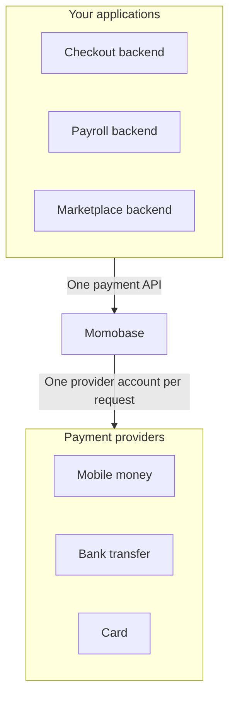
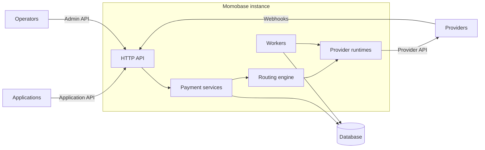

# What is Momobase?

Momobase is a self-hosted payment service. Your applications send collections (money in) and disbursements (money out) to one API. Momobase sends each payment to a payment provider you have configured, such as MTN MoMo or Airtel Money, and tracks it until it reaches a final status.

You run Momobase yourself and keep your own contract with each provider. Momobase is not a payment provider, a merchant of record, a checkout page, or an order system.

## How you run it

| Piece                       | What it is                                                                  | Use it to                               |
| --------------------------- | --------------------------------------------------------------------------- | --------------------------------------- |
| [Momobase Server](/server/) | A ready-to-run binary and container image, with an administration dashboard | Run Momobase as a service               |
| [Go package](/library/)     | The same engine as a Go library                                             | Build Momobase into your own Go program |
| [SDKs](/sdk/)               | TypeScript and Python clients                                               | Call Momobase from your application     |

Not sure which one? See [Choose your integration](/guide/choose). To try it now, follow the [Quickstart](/guide/quickstart).

## What's inside an instance

| Part              | Does                                                                                 |
| ----------------- | ------------------------------------------------------------------------------------ |
| HTTP API          | Authenticates applications and administrators, validates requests, receives webhooks |
| Payment services  | Enforce idempotency, pick a route, call the provider, save each status change        |
| Provider runtimes | Hold the loaded provider adapters, their health, and their circuit breakers          |
| Workers           | Check provider health, follow up on unresolved payments, delete expired sessions     |
| Database          | SQLite, PostgreSQL, or MySQL                                                         |

## Key terms

| Term                 | Meaning                                                                                                            |
| -------------------- | ------------------------------------------------------------------------------------------------------------------ |
| **Application**      | One API consumer, such as your checkout backend. It accepts payments in one currency                               |
| **Credential**       | A client ID and secret for an application, limited to the scopes you grant                                         |
| **Administrator**    | A person or tool that manages Momobase through the dashboard or Admin API                                          |
| **Provider adapter** | Go code that talks to one payment provider's API                                                                   |
| **Provider account** | Your credentials for one provider, for one country and currency                                                    |
| **Route**            | A rule that sends one service (collection or disbursement) and payment method to a provider account, at a priority |
| **Transaction**      | Momobase's record of one collection or disbursement                                                                |

## Next

- [Quickstart](/guide/quickstart): run Momobase and make a test payment.
- [Payment lifecycle](/guide/payment-lifecycle): what happens to a payment after you send it.
- [Routing](/guide/routing): how Momobase picks a provider account.
- [Go live](/guide/go-live): what production needs.
