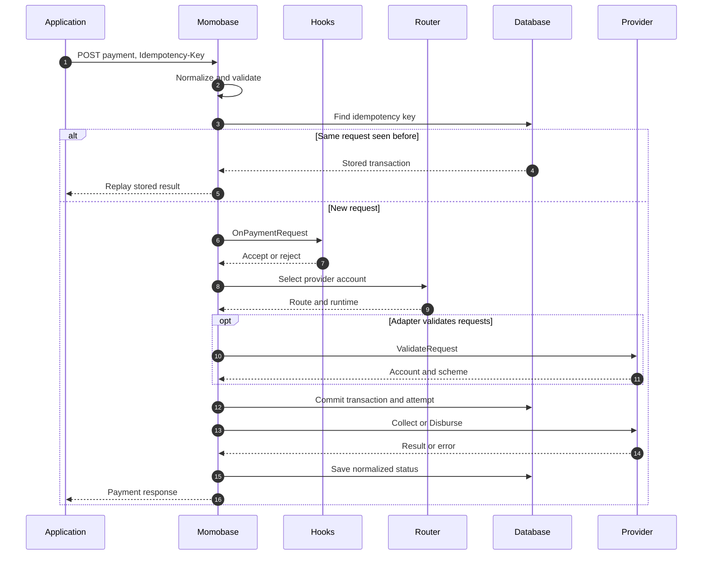
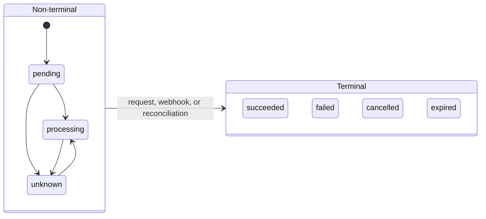

# Payment lifecycle

What happens to a collection or disbursement from the moment your application sends it until it reaches a final status.

## The request

Your application sends the payment with an `Idempotency-Key` header. Momobase then:

Momobase saves the transaction before it calls the provider. If the provider call fails or times out, the transaction is already recorded and Momobase follows it up.

## Validation

Momobase checks these fields on every payment:

| Field            | Rule                                                      |
| ---------------- | --------------------------------------------------------- |
| `payment_method` | `momo`, `card`, `bank_transfer`, or `wallet`              |
| `amount`         | A positive integer in the currency's minor unit           |
| `currency`       | Three letters, and the same as the application's currency |
| `country`        | An ISO 3166-1 alpha-2 code, such as `UG`                  |
| `reference`      | Required                                                  |
| `account`        | Required. The provider adapter may also check its format  |

Momobase uppercases `currency` and `country`, lowercases `payment_method` and `scheme`, and trims `account`.

## Idempotency

- `Idempotency-Key` is required on every collection and disbursement. Keys are per application.
- Sending the same request with the same key returns the stored transaction. The provider is not called again.
- Sending a different request with a used key fails.

Use an ID from your own system, such as an order ID, as the key, and send the same body on every retry.

## Transaction states

| Status       | Meaning                                                               |
| ------------ | --------------------------------------------------------------------- |
| `pending`    | Saved, not yet confirmed by the provider                              |
| `processing` | The provider accepted it and is working on it                         |
| `unknown`    | The provider call failed or gave no answer. Momobase will check again |
| `succeeded`  | Final. The money moved                                                |
| `failed`     | Final. The provider rejected it                                       |
| `cancelled`  | Final. It was cancelled                                               |
| `expired`    | Final. It expired before completing                                   |

A final status never changes.

## How a payment reaches a final status

A payment can be updated from three places. All three follow the same state rules.

| Source                  | When                                                                                                                             |
| ----------------------- | -------------------------------------------------------------------------------------------------------------------------------- |
| The provider's response | Right after Momobase calls the provider                                                                                          |
| A webhook               | The provider calls `POST /webhooks/<provider-account-id>`. See [webhook authentication](/api/conventions#webhook-authentication) |
| Reconciliation          | A worker asks the provider for the status of every unresolved payment. It retries with growing delays, up to 32 minutes apart    |

Momobase never sends a saved payment to a different provider. An unresolved payment is always checked against the provider it was sent to.

## Get notified of changes

- **From your application:** read the transaction with `GET /api/v1/transactions/<id>`, or by your reference.
- **In Go:** register an `OnTransactionChanged` [hook](/library/hooks). It runs after every saved status change.

See [Operate the server](/server/operations) to check workers and provider health.
