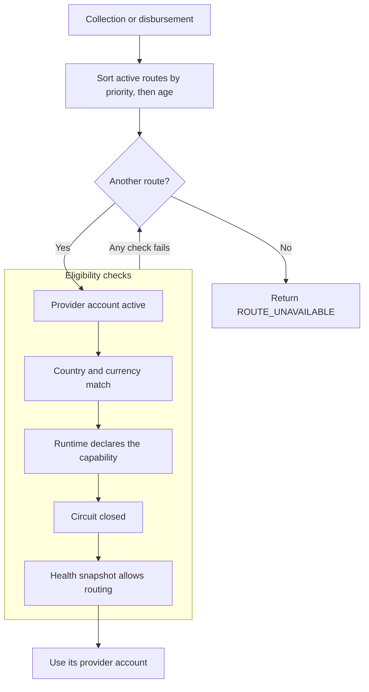

# Routing

Routing picks the provider account for each payment. You control it by creating routes.

## What a route is

A route connects one **service** (`collection` or `disbursement`) and one **payment method** (`momo`, `card`, `bank_transfer`, or `wallet`) to a provider account, with a **priority**. Lower numbers are tried first. Routes with the same priority are tried oldest first.

You can create a route only for a provider account that is active and loaded, and only for a service and payment method its adapter supports.

## How a provider account is picked

A route is used only if all of these are true:

1. The route is active and matches the payment's service and payment method.
2. Its provider account is active.
3. The provider account's country and currency match the payment.
4. The provider account is loaded and its adapter supports the service and payment method.
5. Its circuit breaker is closed.
6. Its latest health check is not `down`, `disabled`, or `misconfigured`. A provider account that has never been checked can be used.

If no route passes, the payment fails with `ROUTE_UNAVAILABLE`. Work through [Diagnose ROUTE_UNAVAILABLE](/server/operations#diagnose-route-unavailable).

## Fallback

To add a backup provider, create a second route for the same service and payment method with a higher priority number. Momobase uses it whenever the first route fails a check above. [Add a backup provider](/tutorials/dashboard-fallback) walks through it.

Fallback happens only while picking a route. Once a payment is saved and sent to a provider account, Momobase never resends it to another provider, even if the call fails.

## Circuit breaker and health

| Mechanism       | Opens when                                            | Effect                                                                                           |
| --------------- | ----------------------------------------------------- | ------------------------------------------------------------------------------------------------ |
| Circuit breaker | 3 provider calls in a row fail                        | Routes to the account are skipped for 30 seconds, then one test call decides whether to close it |
| Health worker   | 3 health checks in a row fail, or the circuit is open | The account is marked `down` and its routes are skipped until a check succeeds                   |

Invalid customer data and calls cancelled by your application don't count as failures.

## Check what can route

`GET /api/v1/payment-methods` lists the service and payment method pairs that can route right now. Filter with `service_type` and `country`. The currency comes from the application. A payment can still fail if something changes between this call and the payment.
