# Deploy the server

```mermaid
architecture-beta
    service apps(server)[Application services]
    service lb(internet)[TLS proxy or load balancer]
    service providers(internet)[Payment providers]
    group replicas(cloud)[momobase serve replicas]
    junction jt1 in replicas
    junction jt2 in replicas
    junction jt3 in replicas
    service r1(server)[Workers on] in replicas
    service r2(server)[Workers off] in replicas
    service r3(server)[Workers off] in replicas
    junction jb1 in replicas
    junction jb2 in replicas
    junction jb3 in replicas
    service db(database)[PostgreSQL or MySQL]
    apps:R --> L:lb
    providers:L -[Webhooks]-> R:lb
    r3{group}:T -[Payment APIs]-> B:providers
    lb:B --> T:jt2
    jt2:L -- R:jt1
    jt2:R -- L:jt3
    jt1:B --> T:r1
    jt2:B --> T:r2
    jt3:B --> T:r3
    r1:B -- T:jb1
    r2:B -- T:jb2
    r3:B -- T:jb3
    jb1:R -- L:jb2
    jb3:L -- R:jb2
    jb2:B --> T:db
```

## What you need

- A host or orchestrator that runs the container image or the binary.
- An HTTPS address and a TLS proxy or load balancer in front of the server.
- PostgreSQL or MySQL if you run more than one replica. SQLite works for a single host.
- The [three secrets](/server/configuration#secrets).
- Backups for the database and the encryption key.

## Steps

1. [Turn on production checks](#turn-on-production-checks).
2. [Choose a database](#choose-a-database).
3. [Terminate TLS in front](#terminate-tls-in-front).
4. [Control migrations](#control-migrations).
5. [Assign worker ownership](#assign-worker-ownership).
6. [Configure probes](#configure-probes).
7. [Scale and restart](#scale-and-restart).

Then work through the [go-live checklist](/guide/go-live).

## Turn on production checks

Set `APP_ENV=production`. The server then refuses to start with a missing secret, a non-HTTPS public URL, or another unsafe setting. See [Staging and production validation](/server/configuration#staging-and-production-validation).

## Choose a database

| Deployment            | Database                    |
| --------------------- | --------------------------- |
| One host, one replica | SQLite or a shared database |
| More than one replica | PostgreSQL or MySQL         |

- With SQLite in the container, mount the `/data` volume: `-v momobase-data:/data`. Without it, the database is deleted with the container.
- With PostgreSQL over a network, set `DB_SSLMODE=require`. Production checks reject `disable` for any host other than `db`, `localhost`, or `127.0.0.1`.

## Terminate TLS in front

The server does not serve HTTPS itself. Put a proxy or load balancer in front of it and set:

| Variable               | Value                                            |
| ---------------------- | ------------------------------------------------ |
| `APP_PUBLIC_URL`       | The `https://` URL callers use                   |
| `TRUSTED_PROXY_CIDRS`  | The addresses of your proxies, and nothing else  |
| `CORS_ALLOWED_ORIGINS` | The browser origins that call the API; never `*` |

If `TRUSTED_PROXY_CIDRS` is empty behind a proxy, every client shares one rate limit. Check the [request and rate limits](/api/conventions#content-type-and-request-limits) when you size the proxy.

## Control migrations

`AUTO_MIGRATE=true` (the default) applies migrations at start-up. That is fine for a single instance. For several replicas, set `AUTO_MIGRATE=false` on all of them and migrate once per release:

1. Back up the database and the encryption key.
2. Make sure the running release works with the new schema, or stop writes.
3. Start one instance with `AUTO_MIGRATE=true`, and wait for it to finish migrating.
4. Roll out the remaining replicas.

Migrations only go forward. There are no down migrations. Never run a replica against a schema its version does not support.

## Assign worker ownership

Every process with `WORKERS_ENABLED=true` runs its own health, reconciliation, and cleanup workers. Replicas do not coordinate.

Set `WORKERS_ENABLED=true` on exactly one replica and `false` on the rest. If that replica fails, enable workers on another one.

## Configure probes

| Endpoint                      | Use for                           | Authenticated |
| ----------------------------- | --------------------------------- | ------------- |
| `/ping`                       | Liveness                          | No            |
| `/healthz`                    | Readiness                         | No            |
| `/api/admin/system/health`    | Database and runtime diagnostics  | Yes           |
| `/api/admin/health/providers` | Provider health and circuit state | Yes           |

The container's health check calls `/healthz`. Neither `/ping` nor `/healthz` checks providers, so a provider outage does not restart the server. Alert on provider health separately.

## Scale and restart

Replicas share nothing except the database, so you can add more once workers are assigned. Give each replica at least 10 seconds to shut down, the length of its HTTP shutdown window.

## Providers

The published build includes `dummy`, `mtn`, `airtel`, `yopayments`, `marzpay`, and `flutterwave`. See [Included providers](/server/#included-providers). For any other provider, fork the server repository, add the adapter to `providers/providers.go`, and build your own image, or [embed the Go package](/library/). [Compare the two](/guide/choose).

Next: [Operate the server](/server/operations).
