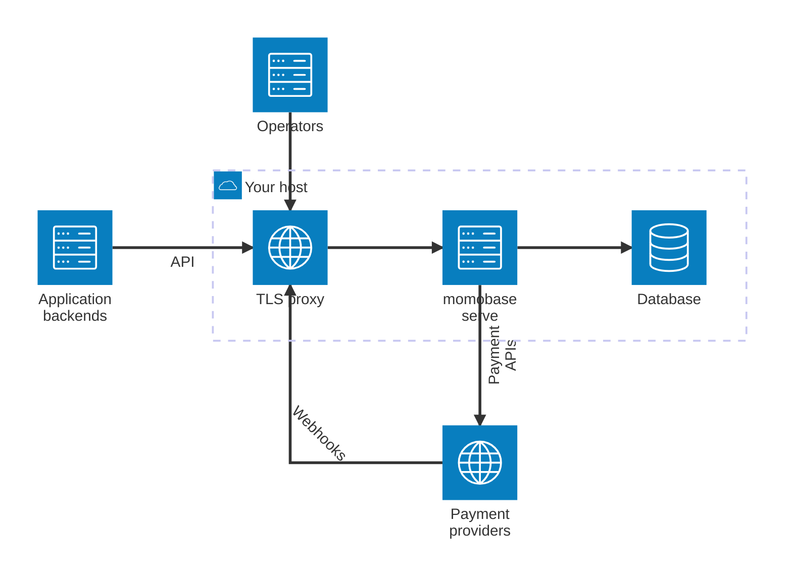

# Momobase Server

<div style="display:flex;gap:1rem;">

[](https://github.com/momobasehq/server/releases/latest)

[](https://github.com/momobasehq/server/pkgs/container/server)

[](https://github.com/momobasehq/server/actions/workflows/ci.yml)

[](https://github.com/momobasehq/server/blob/main/LICENSE.txt)

</div>

```sh
docker run -p 9090:9090 -v momobase-data:/data ghcr.io/momobasehq/server
```

Momobase Server is Momobase as one ready-to-run binary: the HTTP API, the payment provider adapters, and the administration dashboard. You configure it with environment variables and call it over HTTP.

## What you need

- Docker, or a Linux, macOS, or Windows machine to run the release binary.
- No Go toolchain, unless you build from source.



## What it includes

| Part                     | Where                                                                                |
| ------------------------ | ------------------------------------------------------------------------------------ |
| Application API          | `/api/v1`                                                                            |
| Admin API                | `/api/admin`                                                                         |
| Provider webhooks        | `/webhooks/:providerAccountID`                                                       |
| Administration dashboard | `/_`                                                                                 |
| Your static files        | `/`, from a `mb_public` directory beside the binary                                  |
| Command-line interface   | `serve`, `seed-admin`, `version`, `self-update` — see [CLI](/server/cli)             |
| Configuration            | Environment variables and a `.env` file — see [Configuration](/server/configuration) |

The payment engine, API, and database schema come from [the Go package](/library/).

## Included providers

The published builds include these provider adapters. Use the code when you create a provider account.

| Code          | Provider          | Collections        | Disbursements | Verified webhooks |
| ------------- | ----------------- | ------------------ | ------------- | ----------------- |
| `dummy`       | In-tree simulator | Simulated          | Simulated     | No                |
| `mtn`         | MTN MoMo          | Mobile money       | Mobile money  | No                |
| `airtel`      | Airtel Money      | Mobile money       | Mobile money  | No                |
| `yopayments`  | Yo! Payments      | Mobile money       | Mobile money  | No                |
| `marzpay`     | MarzPay           | Mobile money, card | Mobile money  | Yes               |
| `flutterwave` | Flutterwave       | Mobile money       | Mobile money  | Yes               |

You configure each provider account in the dashboard or the Admin API. Provider credentials never go in the environment.

`dummy` moves no money. Use it to test a new deployment before you have real credentials.

::: warning The official providers are under testing
Most of these adapters have not yet run against a live merchant account in every market. Start in each provider's sandbox. MarzPay has no sandbox: its adapter always calls the live API. Report what you find using [TESTING.md](https://github.com/momobasehq/providers/blob/main/TESTING.md).
:::

::: info Need another provider?
Adapters are compiled in. To add one, either fork the server repository, register the adapter in `providers/providers.go`, and build your own image or binary, or [embed the Go package](/library/) in your own program. [Compare the two](/guide/choose).
:::

## Next

1. [Install the server](/server/install).
2. [Follow the Quickstart](/guide/quickstart).
3. [Go live](/guide/go-live) when you are ready for real payments.
